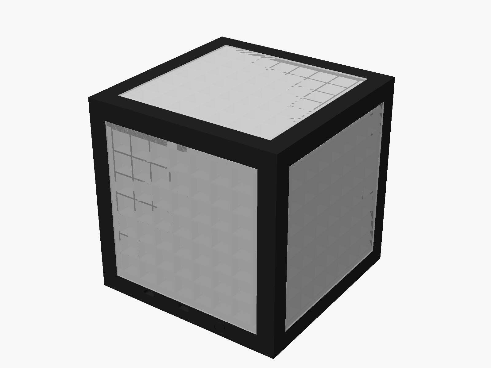
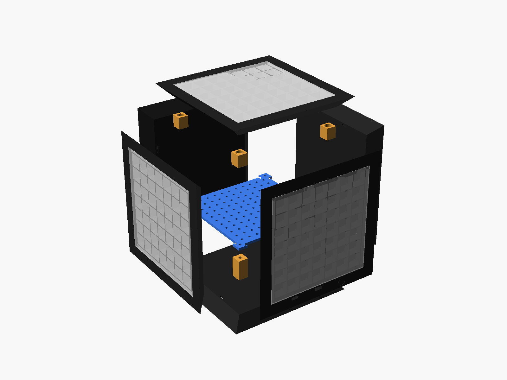
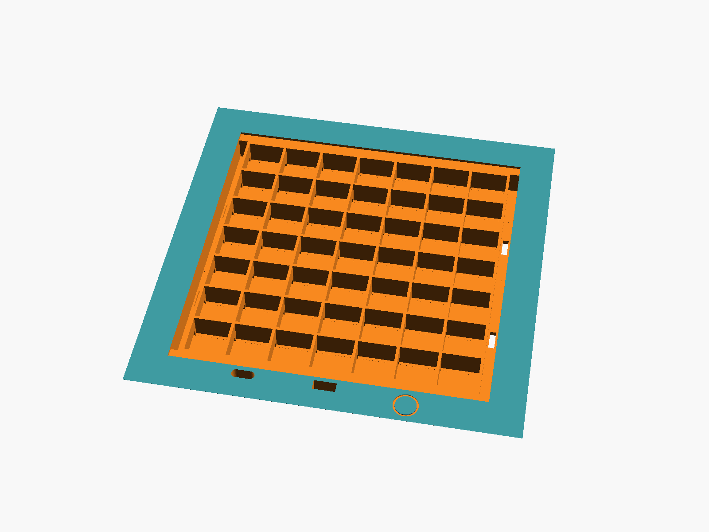

# Magic Cube — estructura impresa

Cubo de **154 mm** de lado: 6 caras iguales con bordes a 45°, rejilla de 7×7 celdas
(tira WS2812B de 60 LEDs/m) y difusor encastrado. Las 5 caras inferiores se pegan entre sí;
la superior es la tapa y se sostiene con imanes.




## Archivos
| Archivo | Cantidad | Material |
|---|---|---|
| `stl/tile.stl` | 5 | PLA/PETG negro |
| `stl/tile_service.stl` | 1 | PLA/PETG negro |
| `stl/diffuser.stl` | 6 | PLA/PETG blanco o natural |
| `stl/post_base.stl` | 4 | cualquiera |
| `stl/post_magnet.stl` | 4 | cualquiera |
| `stl/plate.stl` | 1 | cualquiera |

`magic_cube.scad` es el modelo paramétrico. Todas las medidas están al principio del archivo
(tamaño del cubo, ancho de la tira, altura de la rejilla, imanes, etc.). Para regenerar una pieza:

```
openscad --backend=manifold -D 'part="tile"' -o stl/tile.stl magic_cube.scad
```

## Impresión
- **Caras**: con la cara interior (plana) apoyada en la cama, tal como sale el STL.
  Los bordes a 45° se imprimen sin soportes. Capa 0,2 mm, 3 perímetros, 15 % de relleno.
  Unos 60 g cada una (estimado a partir del volumen; el slicer dará el número real).
- **Difusores**: planos, 100 % de relleno, en blanco o natural. Con 1,2 mm el color se ve
  parejo; si se ven los puntos de los LEDs, subir `diff_t` a 1,6 o usar acrílico opal de 2 mm
  (cortado a 125,5 × 125,5 mm, con `diff_t = 2`).
- **Postes y placa**: sin soportes.
- Total aproximado: 360 g de filamento negro y 140 g de blanco.

Antes de imprimir las 6 caras, imprimir **una** cara y un difusor para probar que la tira
entre por debajo de los tabiques y que el difusor calce.

## Compras para la estructura
- 8 imanes de neodimio de 8 × 3 mm (4 en los postes superiores y 4 en la tapa, o 4 arandelas de acero)
- 4 insertos roscados M3 (para soldador) y 4 tornillos M3 × 8
- Conector USB-C hembra suelto (de 2 o 4 pines, con cables)
- Interruptor deslizante SS12D00
- Pegamento: cianoacrilato o epoxi de 5 minutos

## Cara de servicio
En el borde negro de abajo de una de las caras laterales:



| Elemento | Montaje |
|---|---|
| USB-C (izquierda) | entra desde afuera con los cables pasados por el canal; pegar con epoxi |
| Interruptor (centro) | entra desde afuera, la palanca queda asomando |
| Zona táctil (círculo) | el TTP223 entra por el bisel **antes de pegar la cara inferior**, con el lado del sensor hacia afuera; detecta el toque a través de 1 mm de plástico |

## Armado
1. **Tiras**: cortar 42 tramos de 7 LEDs (7 por cara). En cada cara pegarlos sobre la placa
   trasera, pasando por debajo de los tabiques, todos con la flecha de datos alternando
   (zigzag): fila 1 → derecha, fila 2 → izquierda, etc.
2. **Puentes**: unir el final de cada fila con el inicio de la siguiente por las canaletas
   laterales (quedan tapadas por el difusor).
3. **Cables al interior**: DATA IN, DATA OUT, 5 V y GND pasan por las ranuras de las canaletas.
   En la tapa usar un conector desmontable (JST de 3 pines) para poder sacarla.
4. **Cara de servicio**: montar USB-C, interruptor y TTP223.
5. **Pegar el cuerpo**: cara inferior + 4 laterales, de a una, con los biseles a 45°.
   Los biseles se alinean solos.
6. **Postes inferiores**: colocar los insertos M3 con el soldador y pegar un poste en cada
   esquina del fondo.
7. **Electrónica**: la batería va entre los postes, debajo de la placa (24 mm de alto
   disponibles). La ESP32, el IMU, el regulador y el conversor de nivel se atornillan
   o se sujetan con precintos en la grilla de agujeros de la placa (paso 10 mm).
   La placa se atornilla a los postes.
8. **Tapa**: pegar los imanes en los postes superiores. Poner la tapa con sus 4 imanes (o
   arandelas) pegados en el interior, con los postes ya imantados a ella, y recién entonces
   pegar los postes a las paredes. Así quedan a la altura exacta.
   Ojo con la polaridad: probar cada par antes de pegar.
9. **Difusores**: a presión en cada cara. Si quedan flojos, una gota de pegamento en las esquinas.

Para reparar una tira basta con sacar el difusor de esa cara: todas las tiras y los puentes
quedan accesibles desde afuera.

## Medidas clave
| | mm |
|---|---|
| Lado exterior | 154 |
| Espesor de cada cara | 13,2 |
| Hueco interior | 127,6 × 127,6 × 127,6 |
| Zona de LEDs | 116,7 × 116,7 (celdas de 16,7) |
| Difusor | 125,5 × 125,5 × 1,2 |
| Altura de la rejilla (LED → difusor) | 10 |
